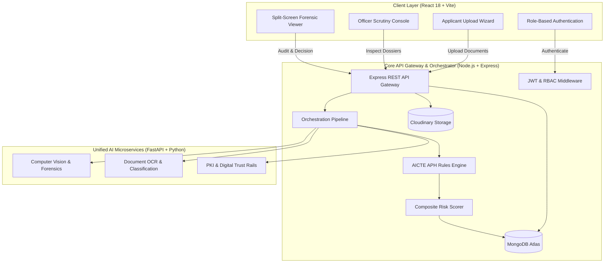

# 🛡️ e-Pramaan (ई-प्रमाण)
### AI-Powered Statutory Document Scrutiny & Regulatory Verification Platform for AICTE

[](https://fastapi.tiangolo.com/)
[](https://nodejs.org/)
[](https://expressjs.com/)
[](https://react.dev/)
[](https://vitejs.dev/)
[](https://www.mongodb.com/atlas)
[](https://tailwindcss.com/)
[](https://www.python.org/)

---

## 📌 Executive Summary

**e-Pramaan** is an automated, AI-driven regulatory compliance verification platform engineered for the **All India Council for Technical Education (AICTE)**. It streamlines the annual statutory document approval process (APH cycle) for higher educational institutions across India.

By uniting **Computer Vision & Forensics**, **Optical Character Recognition (OCR)**, **PKI & Trust Rails (DigiLocker / State University APIs)**, and a **Deterministic APH Rules Engine**, e-Pramaan instantly triages institutional filings into **Compliant (Green)**, **Deficient (Yellow)**, or **High-Risk Forgery (Red)**, enabling scrutiny officers to detect manipulation, ghost faculty, duplicate lab photographs, and unauthorized seat inflation with surgical precision.

---

## 🏗️ System Architecture

e-Pramaan operates as a loosely coupled, resilient three-tier microservice architecture:



---

## 🚀 Key Modules & Capabilities

### 1. 🔍 Forensic Computer Vision Subsystem (`services/forensics`)
- **Error Level Analysis (ELA):** Detects digital image/document manipulation, copy-paste forgery, and Photoshop alterations by analyzing compression differentials.
- **Perceptual Hashing (pHash):** Computes invariant DCT image hashes to prevent cross-institution laboratory and campus infrastructure photo recycling.
- **Font & Typography Inspection:** Scans embedded PDF font definitions to detect spliced numeric values (e.g., tampered sanctioned intake numbers).
- **EXIF & Geotag Validation:** Confirms image acquisition metadata and geolocation matches claimed institutional GPS coordinates.

### 2. 📄 OCR & Document Ingestion Subsystem (`services/ocr`)
- **Pre-Scrutiny Image Quality Control:** Laplacian variance blur detection and automatic deskewing.
- **Document Classification:** Automatically classifies filings into statutory categories:
  - *Fire Safety NOC*
  - *Affiliation Letter*
  - *Land Title Deed / Building Completion*
  - *Faculty Master Roster*
- **Field & Table Extraction:** Uses PyMuPDF and RapidOCR to extract certificate dates, approving authorities, sanctioned programs, and faculty enrollment rosters.

### 3. 🔐 PKI & Trust Rails Subsystem (`services/verification`)
- **X.509 Digital Signature Validation:** Verifies RSA-SHA256 signatures, cryptographic checksums, and document certificates.
- **Encrypted QR Code Decoder:** Decodes and cross-references statutory QR payloads against document body text.
- **Mock Trust Rails:** Live-simulated endpoints for DigiLocker certificate authentication and State University Affiliation Registries.

### 4. ⚖️ AICTE APH Rules Engine & Scorer (`backend/src/engine`)
- **Student-to-Faculty Ratio (SFR):** Enforces $\le 1:15$ for UG Engineering and $\le 1:20$ for Management.
- **Cadre Ratio & Leadership:** Validates minimum senior cadre (Professors / HoDs) per department.
- **Built-Up Area & Land Mandates:** Audits carpet area per student ($\ge 5.5\text{ m}^2$) and minimum operational campus land ($\ge 2.5\text{ acres}$).
- **Safety Mandates:** Validates fire NOC validity for the active academic approval cycle.
- **Ghost Faculty Deduplication:** Audits PAN / Aadhaar / National ID hashes across central database registries to intercept faculty teaching concurrently at multiple colleges.
- **Dynamic Risk Triaging:**
  - 🟢 **Green (Compliant):** Risk score $< 25$, all ratios satisfied, authentic PKI.
  - 🟡 **Yellow (Deficiency):** Risk score $25\text{–}60$, minor administrative or infrastructural shortfalls.
  - 🔴 **Red (High Risk / Fraud):** Risk score $> 60$, forged certificates, expired safety documents, or duplicate faculty.

### 5. 🖥️ Officer Split-Screen Inspection Console (`client/src`)
- **Side-by-side inspection:** View original applicant PDF on the left alongside automated AI extractions and forensic overlays on the right.
- **One-Click Regulatory Actions:** Formal Approval, Deficiencies Flagged, or Rejection with immutable audit logs.

---

## 📂 Repository Directory Layout

```text
e-Pramaan/
├── backend/                  # Node.js Express Core Gateway & Orchestrator
│   ├── src/
│   │   ├── config/           # MongoDB Atlas, Cloudinary & Seed configs
│   │   ├── controllers/      # Auth, Scrutiny, Document, Institution controllers
│   │   ├── engine/           # Deterministic APH Rules & Ratio Calculators
│   │   │   └── rules/        # Academic, Infrastructure, Intake, Safety rules
│   │   ├── middleware/       # JWT Auth & Global Error handling
│   │   ├── models/           # Mongoose schemas (Application, User, DocumentRecord, AuditTrail)
│   │   ├── routes/           # REST endpoints
│   │   ├── services/         # Orchestration Pipeline, Risk Scorer, Microservice client
│   │   └── server.js         # HTTP server entrypoint
│   ├── package.json
│   └── .env.example
│
├── client/                   # React 18 + Vite Web Application
│   ├── src/
│   │   ├── assets/           # UI media & brand assets
│   │   ├── components/
│   │   │   ├── applicant/    # Multi-step Upload Wizard
│   │   │   ├── auth/         # Role-based Login Screen with 1-click demo logins
│   │   │   ├── layout/       # Navbar & Global layout
│   │   │   └── officer/      # Scrutiny Console & Split-Screen Dossier Viewer
│   │   ├── config/           # API client configuration
│   │   ├── App.jsx           # Root application component
│   │   └── main.jsx
│   ├── package.json
│   ├── tailwind.config.js
│   └── .env.example
│
├── services/                 # Unified Python AI & Forensics Microservices
│   ├── forensics/            # ELA engine, font inspector, pHash registry, geotag validator
│   ├── ocr/                  # Preprocessors, document classifiers, OCR table/text extractors
│   ├── verification/         # PKI validator, QR decoder, DigiLocker & University mock rails
│   ├── main.py               # FastAPI application aggregator
│   ├── requirements.txt      # Python dependencies
│   └── .env.example
│
└── test-suite/               # Synthetic Dossier Generators & Benchmark Test Cases
    ├── benchmarks/           # Automated accuracy & latency benchmark runner
    ├── cases/                # Clean, expired NOC, ghost faculty, and tampered intake cases
    └── generators/           # Programmatic PDF generator using ReportLab
```

---

## 🛠️ Prerequisites

Ensure you have the following installed on your machine:
- **Node.js:** `v18.0.0` or higher
- **npm:** `v9.0.0` or higher
- **Python:** `v3.10` or higher (Python 3.11 / 3.12 recommended)
- **MongoDB:** Active MongoDB Atlas connection URI (or local MongoDB running on `mongodb://localhost:27017`)

---

## ⚡ Quick Start & Local Setup

### 1. Clone the Repository
```bash
git clone https://github.com/NexusNitw/e-Pramaan.git
cd e-Pramaan
```

---

### 2. Configure Environment Files

Create the required `.env` files in each subsystem:

#### Backend (`backend/.env`):
```env
PORT=5000
NODE_ENV=development
MONGODB_URI=your_mongodb_connection_string
JWT_SECRET=aicte_epramaan_jwt_secret_key_2026
PYTHON_SERVICES_URL=http://localhost:8000
CLIENT_URL=http://localhost:5173
CLOUDINARY_CLOUD_NAME=your_cloud_name
CLOUDINARY_API_KEY=your_api_key
CLOUDINARY_API_SECRET=your_api_secret
```

#### Client (`client/.env`):
```env
VITE_API_URL=http://localhost:5000
```

#### Python Services (`services/.env`):
```env
PORT=8000
HOST=0.0.0.0
ENVIRONMENT=development
DEBUG=True
DIGILOCKER_API_MOCK=True
UNIVERSITY_REGISTRY_MOCK=True
```

---

### 3. Install Dependencies & Launch Services

You will need **3 terminal windows** to run the complete stack:

#### Terminal 1: Python AI & Forensics Services
```bash
# In repository root:
pip install -r services/requirements.txt
python -m uvicorn services.main:app --host 0.0.0.0 --port 8000 --reload
```
- **Service Endpoint:** `http://localhost:8000`
- **Swagger Documentation:** `http://localhost:8000/docs`

#### Terminal 2: Backend API Gateway & Rules Engine
```bash
cd backend
npm install
npm run dev
```
- **Gateway Endpoint:** `http://localhost:5000`
- **Health Check:** `http://localhost:5000/api/health`
- *Note: On initial boot, MongoDB Atlas is automatically seeded with demo accounts and canonical AICTE APH compliance rules.*

#### Terminal 3: React Frontend Client
```bash
cd client
npm install
npm run dev
```
- **Web App URL:** `http://localhost:5173`

---

## 🔑 Pre-Seeded Demonstration Accounts

The login interface features **1-click instant login buttons** for evaluators:

| Role | Email | Password | Primary Permissions |
|---|---|---|---|
| **Scrutiny Officer** | `officer@aicte.gov.in` | `Password@123` | Inspect Dossiers, Forensic Analysis, Triage Approval/Rejection |
| **Applicant** | `applicant@college.edu.in` | `Password@123` | Institutional Profile, Statutory Document Upload Wizard |
| **Administrator** | `admin@aicte.gov.in` | `Password@123` | Dual Portal Switcher, Full Audit Logs, Rules Configuration |

---

## 🧪 Synthetic Regulatory Dossier Test Suite

e-Pramaan includes a synthetic PDF dossier generator to benchmark fraud detection capabilities against adversarial scenarios:

```bash
# Run benchmark suite
python test-suite/benchmarks/benchmark_runner.py

# Generate test PDF dossiers (Clean, Tampered, Expired NOC, Ghost Faculty)
python test-suite/generators/generate_test_dossiers.py
```

### Pre-packaged Adversarial Test Cases:
1. **TC-01 (Clean Compliant):** Authentic institutional filing adhering to all APH norms.
2. **TC-02 (Expired Fire NOC):** Fire safety certificate with lapsed validity dates.
3. **TC-03 (Tampered Intake):** State university affiliation decree digitally altered via Photoshop to inflate sanctioned seats.
4. **TC-04 (Ghost Faculty Collision):** Cross-institutional faculty duplication with conflicting national identifiers.
5. **TC-05 (Facility Photo Reuse):** Duplicate laboratory/campus photographs flagged by perceptual hashing.

---

## 📡 REST API Reference Summary

| Endpoint | Method | Service | Description |
|---|---|---|---|
| `/api/auth/login` | `POST` | Backend | Authenticate user & issue JWT token |
| `/api/auth/me` | `GET` | Backend | Fetch current user profile & role |
| `/api/applications` | `GET` / `POST` | Backend | List application dossiers / Create new dossier |
| `/api/documents/upload` | `POST` | Backend | Upload statutory document (Cloudinary + Local) |
| `/api/scrutiny/:id/run` | `POST` | Backend | Execute full multi-service scrutiny pipeline |
| `/api/scrutiny/:id/decision` | `POST` | Backend | Record officer regulatory determination |
| `/api/forensics/analyze` | `POST` | Python | Error Level Analysis (ELA) & metadata check |
| `/api/ocr/classify` | `POST` | Python | Automatic statutory document classification |
| `/api/ocr/extract` | `POST` | Python | Extract tables, parameters & dates from PDF |
| `/api/verify/all` | `POST` | Python | Validate PKI digital signature, QR & Trust Rails |

---

## 🛡️ Security & Privacy
- **Statutory Non-Repudiation:** All officer approvals and rejections are recorded in an append-only MongoDB `AuditTrail` log.
- **Privacy Preservation:** Sensitive national identifiers (e.g., PAN, Aadhaar) are hashed before cross-institution collision audits.
- **Role-Based Access Control (RBAC):** Strict boundaries separating applicant uploads from internal regulatory scrutiny consoles.

---

## 👥 Contributors & Acknowledgements

Developed by **Team Nexus** for the **AICTE e-Pramaan Initiative**.

- *Special thanks to the open-source community behind FastAPI, OpenCV, PyMuPDF, ReportLab, and RapidOCR.*
